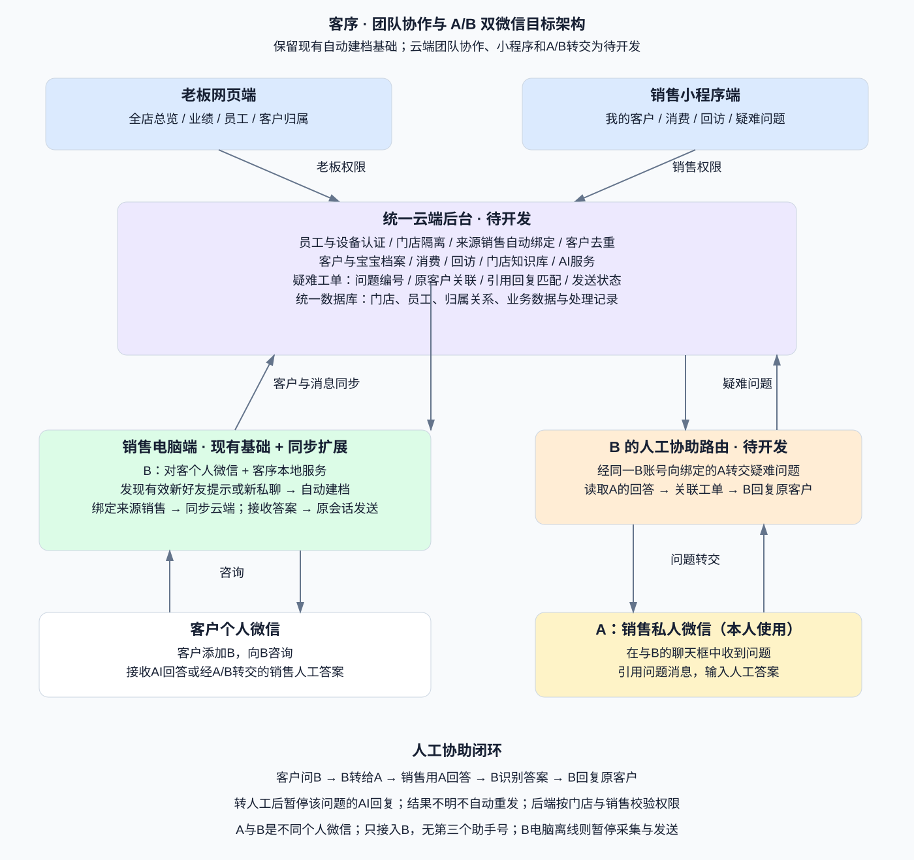
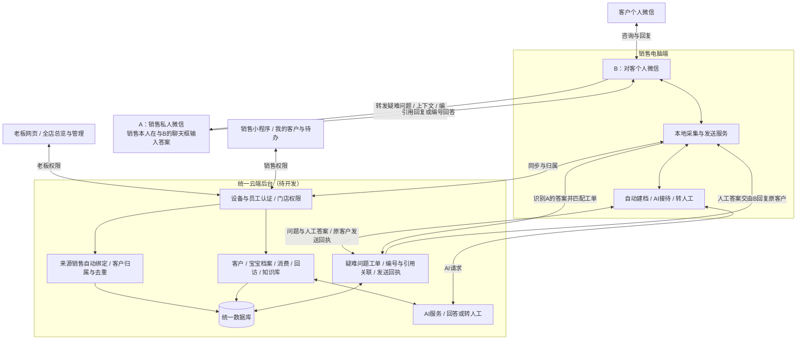

# 团队协作与 A/B 双微信目标架构

本文件描述目标产品方案，并不表示功能已经实现。原有架构图继续保留：[当前工作台架构](architecture.svg)。

## 可编辑流程图

## 各端职责

| 端 | 职责 |
|---|---|
| 销售电脑端 | 登录B：对客个人微信；发现有效新好友提示或新私聊后自动建档；上传数据并携带已绑定的销售身份；执行获准的消息发送 |
| A：销售私人微信 | 由销售本人使用，接收 B 转来的问题，并在与 B 的聊天框输入人工答案 |
| 销售小程序 | 查看本人客户、宝宝档案、消费、回访任务、疑难问题与处理记录 |
| 老板网页 | 查看全店经营、销售业绩、客户归属和疑难问题处理情况，管理员工与门店知识库 |
| 统一后台 | 设备及员工认证、门店隔离、客户归属、同步去重、业务接口、AI与工单管理 |

A 与 B 是两个不同的个人微信号。客户添加 B，系统只需接入 B；A 正常使用微信，不要求另装采集服务，不存在第三个助手号。每个 B 必须明确绑定所属销售与其私人号 A，不能按昵称识别。

## 客户归属

客户由来源销售的电脑服务自动建档并绑定该销售，不依赖老板分配。现有本机自动建档能力需要接入员工身份及云端同步后，才能实现团队归属。单一客户关联多个销售时需保留来源记录，具体主负责人和冲突规则待确认，不能静默覆盖。

## 微信助手转交疑难问题（新增、待开发）

1. 客户向B：对客个人微信咨询，系统依据门店知识与接待规则判断是否可以可靠回答。
2. 需要人工时创建唯一问题编号，记录门店、销售、客户、原会话和必要上下文，暂停该问题的自动回复。
3. 系统通过 B 把客户称呼、问题、必要上下文与编号发送给该销售的私人微信 A。
4. 销售使用 A，在与 B 的聊天框中引用问题回复；B 的本机服务识别 A 的入站回答并解析引用关联。无法可靠解析引用时要求明确问题编号，不能按最近问题猜测客户。
5. 后台核验回答确实来自预先绑定的 A，并校验销售权限及问题状态，将人工答案交给 B 的电脑服务，由 B 发送到对应客户原会话。
6. 通过发送回执更新状态，两端同步处理记录。发送结果不明转人工核查，不盲目重发。

状态建议：待销售回答 → 待发送 → 已发送；失败及结果不明单独记录。人工接管、重复回答、问题取消、设备离线与跨销售回答都必须明确处理；A 与 B 的协助会话排除客户自动建档、欢迎和 AI 接待，防止循环。

## 已有基础与新增范围

- 已有代码基础：Windows本机微信读取、新私聊自动建档、接待及发送处理。自动建档受本机服务启动、接待开关和有效消息等条件约束，不是小程序直接监听个人微信好友。
- 待开发：门店与销售账号体系、电脑设备绑定、云端同步、客户归属和团队权限、老板经营总览、销售小程序、B 对接 A 的转交及疑难工单闭环。
- 仓库文档记录过单一真实新增好友建档验证；不能扩大为多销售、500客户或长期无人值守验收。
- 网页与小程序使用已同步的数据；电脑离线时暂停该电脑的微信采集及发送。B 的电脑微信和本地服务需要持续运行；A 可以直接使用手机微信。
