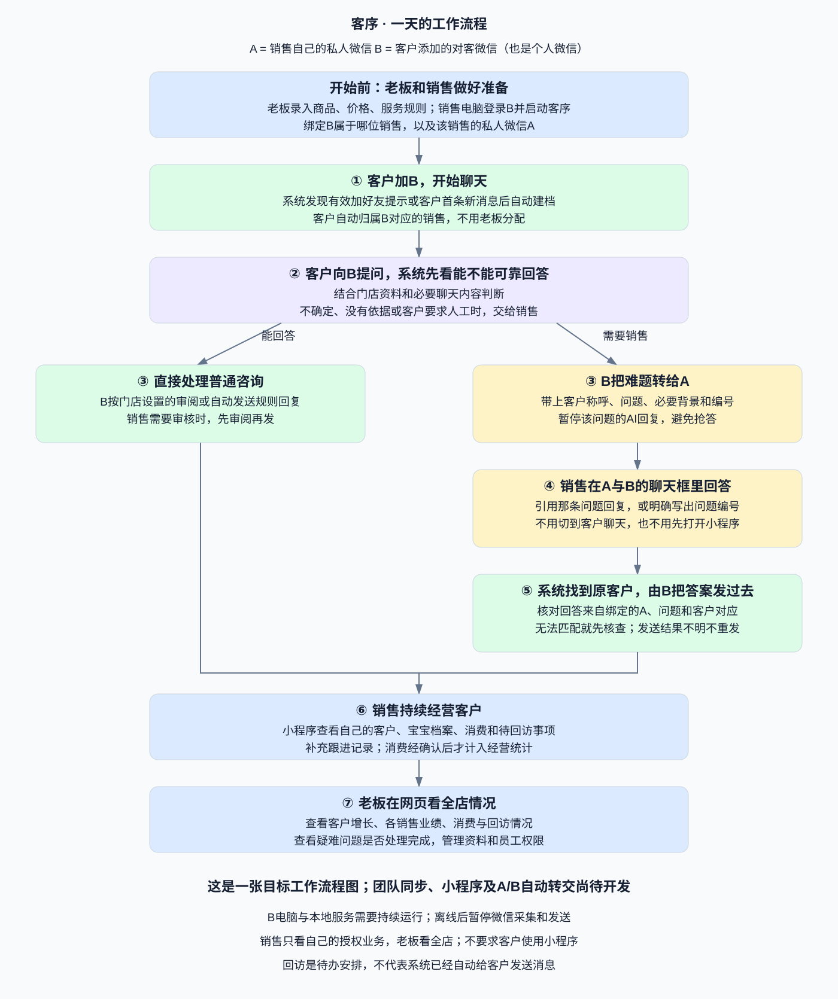

# 工作流程 · 通俗版

## 先记住两个微信

- A：销售自己的私人微信，销售本人用它回答难题。
- B：客户添加的对客个人微信，系统通过它接待客户。
- 没有第三个助手微信号；客户不需要使用销售小程序。

## 按一天的工作顺序看

1. **准备**：老板维护商品、价格和服务资料；销售电脑登录B，绑定销售身份与私人号A，启动本地服务并开启相关功能。
2. **获客**：客户加B并开始交流。检测到有效加好友提示或首次新私聊后，自动建档，归属B对应的销售，不由老板分配。
3. **普通咨询**：有明确依据的问题，由B按门店审阅或自动发送规则回复。
4. **疑难咨询**：B把问题、客户称呼、必要背景和唯一编号发给A，暂停该问题的AI回复。
5. **销售解答**：销售在A与B聊天框引用问题回答；不能解析引用时明确问题编号，不按最近一条猜测。
6. **回复客户**：系统核对A身份、工单和原客户，交给B回复。无法匹配或发送结果未知时转人工核查，不盲目重发。
7. **持续跟进**：销售用小程序维护自己的客户、宝宝档案、消费和回访记录；确认消费后才纳入统计。
8. **老板管理**：老板在网页看全店客户、销售业绩、消费、回访与疑难问题处理情况。

## 三个使用入口

| 入口 | 谁用 | 用来做什么 |
|---|---|---|
| A与B的微信聊天 | 销售 | 收到难题，直接回答 |
| 销售小程序 | 销售 | 查看自己的客户与待办，登记业务 |
| 老板网页 | 老板 | 查看全店和团队情况，管理资料与权限 |

## 当前边界

本图描述目标产品流程。电脑微信读取与自动建档等已有基础；销售身份绑定、团队云同步、小程序及A/B疑难转交闭环仍需开发。

B电脑和本地服务持续运行才可采集与发送；离线仍可查看云端已同步的数据。回访待办不等于自动发微信，消费审核和业绩归因等门店规则需另行确认。
