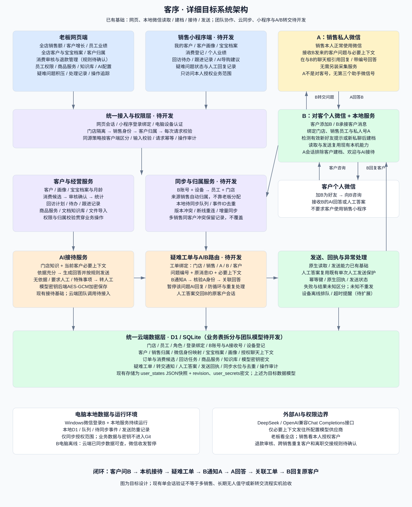
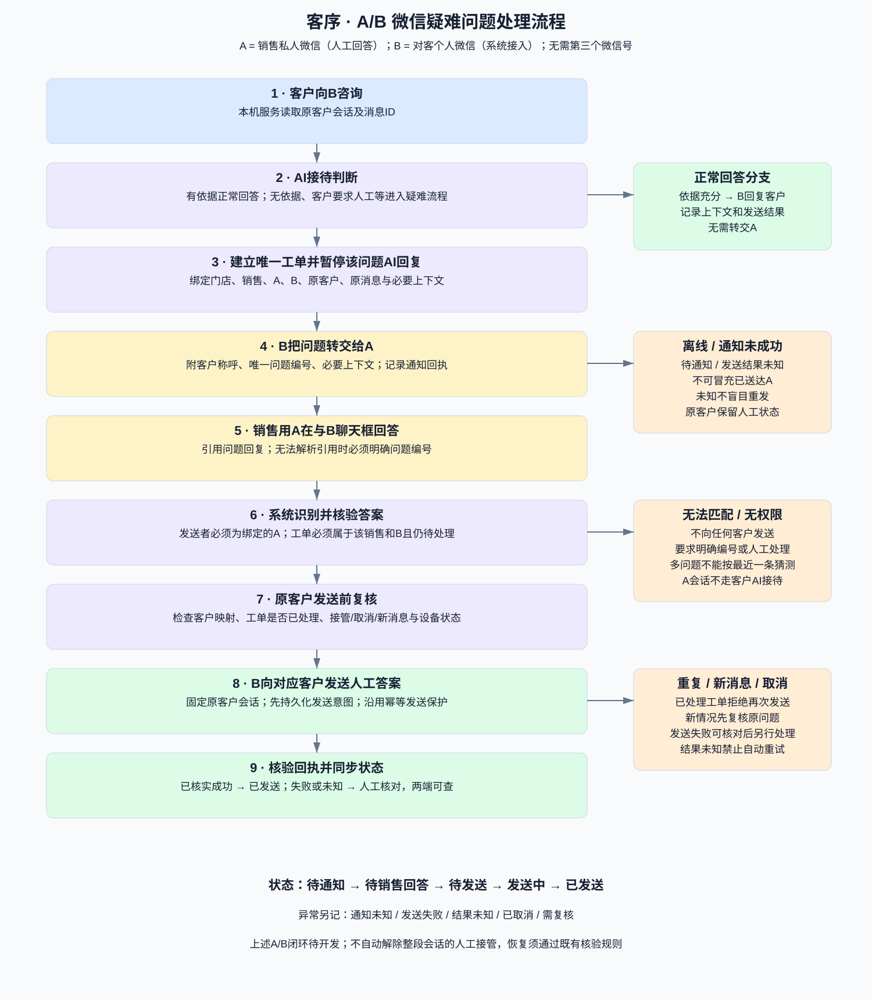

# 客序详细目标架构与A/B人工协助

本文件为目标设计，不代表团队功能或A/B转交已实现。原始图 [architecture.svg](../v1-初始工作台/architecture.svg) 保留；前一版目标概览另存为 [architecture-target-overview.svg](../v2-团队协作与AB双微信/architecture.svg)。

## 完整系统架构

## A/B微信疑难问题处理

A为销售本人的私人微信，B为客户添加的对客个人微信。两者是不同账号，无第三个助手号。系统接入B，销售用A正常收发即可。

### 主流程

1. 客户向B咨询，本机接待判断能否依据门店知识可靠回答。
2. 需要人工时创建唯一工单，关联门店、销售、A、B、客户及原消息，暂停该问题的AI自动回复。
3. 通过B向绑定的A发送客户称呼、问题、必要上下文和编号。
4. 销售在A与B的聊天框引用回复；引用无法可靠解析时必须提供明确问题编号。
5. B的本机服务识别A的回答，核验发送者、工单归属与状态，不能按最近问题猜测客户。
6. 发送前复核原客户映射、重复回答、取消、人工接管及新消息等情况；通过后由B发送到原客户会话。
7. 成功回执核实后更新已发送；结果未知保留人工核查，不自动重发，不自动解除整个客户会话的人工接管。

A与B的协助会话必须排除客户建档、欢迎与AI接待，避免销售私人号被当成客户、转交循环或自动回复人工答案。

## 各端详细职责

| 端 | 目标职责 |
|---|---|
| 老板网页 | 全店销售与客户增长、员工表现、全部客户及宝宝档案、归属查看、消费审核与退款、知识库和模型配置、疑难工单与操作审计 |
| 销售小程序 | 本人客户、画像与宝宝档案、消费登记、回访待办、个人业绩、导购建议、疑难问题处理记录 |
| B电脑本地服务 | 新私聊识别与建档、本机接待、来源销售绑定、数据同步、B转A、接收A回答、原客户消息发送与回执 |
| A销售私人微信 | 接收问题、在与B的聊天框作答，不要求安装本地采集服务 |
| 统一后台 | 登录绑定、员工及设备认证、门店和客户权限、归属、业务接口、AI、同步冲突与去重、工单及状态管理 |

## 后端模块与接口职责（目标设计）

- 身份与权限：网页会话、小程序登录绑定、设备认证；后端根据门店、员工与客户归属校验所有请求。小程序和设备不能照搬仅浏览器同源的校验方式。
- 客户归属：通过来源B账号及员工绑定自动归属，不依赖老板分配。跨销售重复客户保留来源与冲突记录，具体主负责人规则待确认。
- 业务服务：客户、宝宝、消费、回访、商品及知识库。逐步拆分目前整份状态快照，避免多人协作整份覆盖。
- 同步服务：设备事件ID去重、本地待同步队列、增量水位、版本冲突、断线恢复；接收方校验事件中的销售与设备绑定关系。
- AI服务：模型密钥加密，必要上下文与门店知识构成输入；依据充分回答，否则转人工。
- 工单路由：唯一编号绑定门店、销售、A、B、原客户、原消息；人工答案只作用于明确工单，不允许跨销售或跨B使用。
- 发送与审计：先保存发送意图与幂等标识，复用既有人工发送保护；原生回执区分成功、失败和未知。
- 管理端查询：经营汇总、员工表现、工单积压、处理历史。消费审核口径与销售业绩归因需确认后统一。

## 目标数据模型

| 数据组 | 核心记录 |
|---|---|
| 组织身份 | 门店、员工、角色、登录绑定、B账号、对应A接收号、设备 |
| 客户 | 客户身份映射、销售归属、宝宝档案、画像、授权范围内聊天上下文 |
| 经营 | 消费候选、订单、退款、回访任务、跟进记录 |
| 知识与模型 | 商品、服务、文档知识库、模型配置、密钥密文 |
| 工单与运行 | 工单、通知、人工答案、发送回执、同步事件、水位、去重与审计 |

现有数据库以 user_states 的 JSON快照和revision，以及 user_secrets 的AES-GCM密文为主；上表为待实施的团队模型，不表示已有独立业务表。

## 状态与异常

正常状态：待通知 → 待销售回答 → 待发送 → 发送中 → 已发送。通知未知、发送失败、结果未知、已取消、需复核分别记录。

- B电脑离线：两端仍可查云端已同步数据；该端微信读取和发送暂停，恢复后处理待同步数据。
- 通知结果未知：不能把工单标为已送达A，不盲目重发。
- 无引用且无编号、引用不匹配、来源不是A：拒绝自动回传客户。
- 重复答案、取消、归属变化、新客户消息：发送前复核，不使用过期工单猜测。
- 发送结果未知或服务中断：人工核对微信，禁止自动重发；成功必须核验回执。
- 员工离职、客户转交、跨销售重复客户：由门店管理规则处理，具体规则待确认。

## 当前与待开发

已有基础：网页、Windows本机读取、新私聊自动建档、接待、单次人工发送及防重与回执核验。新建档受运行开关与有效事件约束，不等于小程序监听好友。

待开发：团队身份与权限、B/A及设备绑定、云同步、目标业务数据模型、老板团队总览、销售小程序、A/B工单转交及回传。

已有单会话实机记录不能扩大为多销售、500客户、长期运行或本次A/B功能的验证结论。
